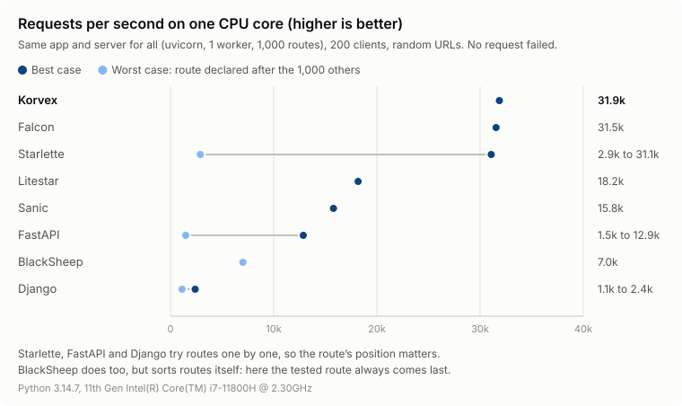
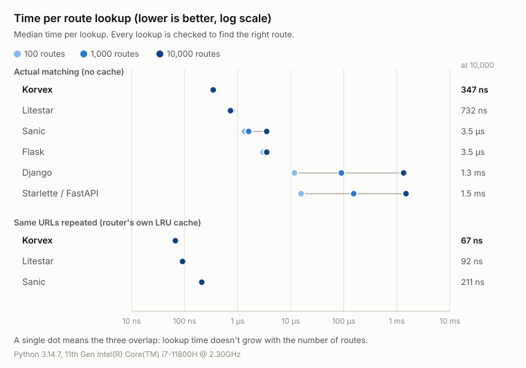

# Korvex

[](https://github.com/3d3n-pyc/korvex/actions/workflows/ci.yml)
[](LICENSE)

A fast router for Python, written in Rust, with an optional ASGI app on top.

Korvex is young (alpha). Its routing is fast (see [Performance](#performance)),
but it lacks much of what full frameworks offer: WebSockets, streaming,
startup hooks, validation, OpenAPI. The [roadmap](ROADMAP.md) lists what's
coming.

```sh
pip install korvex
```

## The router

`Router` maps a path and an HTTP method to a handler **name**. It never
calls your code: what you do with the name is up to you.

```python
from korvex import Router

router = Router()
router.get("/users/{id:int}", "get_user")
router.post("/users", "create_user", middleware=["auth"])

router.match("/users/42")         # ("get_user", {"id": "42"}, ())
router.match("/users", "POST")    # ("create_user", {}, ("auth",))
router.match("/nope")             # None
router.match("/users", "DELETE")  # raises MethodNotAllowed, .allowed == ["POST"]
```

### Path syntax

| Segment     | Matches                              | Example            |
|-------------|--------------------------------------|--------------------|
| `users`     | exactly `users`                      | `/users`           |
| `{id}`      | any segment                          | `/users/{id}`      |
| `{id:int}`  | an integer (`42`, `-7`)              | `/users/{id:int}`  |
| `{id:uuid}` | a UUID                               | `/items/{id:uuid}` |
| `*path`     | the rest of the path (last segment)  | `/static/*path`    |

Captured values are always strings. When several routes could match,
the most specific one wins: literal, then `{id:int}`/`{id:uuid}`, then
`{id}`, then `*path`.

### API

| Method                                           | Does                                                     |
|--------------------------------------------------|----------------------------------------------------------|
| `route(path, handler, *, method="GET", middleware=None)` | Registers a route (replaces an existing one).    |
| `get` / `post` / `put` / `patch` / `delete` / `head` / `options(path, handler, *, middleware=None)` | Shortcuts for `route`. |
| `match(path, method="GET")`                      | `(handler, params, middleware)`, `None`, or raises `MethodNotAllowed`. |
| `remove(path, method="GET")`                     | Removes a route by its pattern. Returns whether it existed. |
| `routes()`                                       | Every route as `(path, method, handler, middleware)`.    |
| `group(prefix, *, middleware=None)`              | A `RouteGroup` (see below).                              |

Invalid paths or methods raise `ValueError`.

`match` keeps the last 1,024 distinct lookups in a cache, and adding or
removing a route clears it. Its results are shared between calls, so they
are immutable: `params` is a read-only mapping and `middleware` a tuple.

### Route groups

```python
api = router.group("/api", middleware=["auth"])
api.get("/users", "list_users")             # GET /api/users, middleware ("auth",)

admin = api.group("/admin", middleware=["admin"])
admin.get("/stats", "stats")                # GET /api/admin/stats, middleware ("auth", "admin")
```

## The ASGI app

`App` runs the matched handler for you. Serve it with any ASGI server
(uvicorn, hypercorn, granian...).

```python
from korvex import App, Response

app = App()

@app.get("/users/{id:int}", middleware=["auth"])
async def get_user(request, id):
    return Response.json({"id": id})

@app.middleware("auth")
def auth(request):
    if request.headers.get("Authorization") is None:
        return Response.text("Unauthorized", status=401)  # stops here
    return None                                          # carries on
```

```sh
pip install "korvex[serve]"   # installs uvicorn
uvicorn mymodule:app
```

- Handlers receive the `Request` plus path params as keyword arguments,
  and return a `Response`. Middleware returns a `Response` to answer
  early, or `None` to continue. Both can be sync or async.
- `Request` has `method`, `path`, `headers`, `query_params`,
  `path_params`, and `await request.body()` / `await request.json()`.
- `Response(body, status=, headers=)`, `Response.text(...)`,
  `Response.json(...)`, `Response.redirect(...)`.
- Unknown paths get a 404; known paths with the wrong method get a 405
  with an `Allow` header.
- Routes registered on `app.router` directly (for example through a
  group) are linked to a function with `@app.handler("name")`.

More in [`examples/`](examples/).

## Performance

### Under load

The same small app (1,000 routes, one JSON endpoint) in each framework,
served the same way (uvicorn, one worker, one CPU core) and flooded with
requests to random URLs by [oha](https://github.com/hatoo/oha):

<picture>
  <source media="(prefers-color-scheme: dark)" srcset="docs/load-dark.svg">
  
</picture>

| Framework | Requests/s, 200 clients | p99 latency, 1,000 clients | RAM at rest, peak |
|---|---|---|---|
| **Korvex** | **33.7k** | **26 ms** | **35 MB, 46 MB** |
| Starlette | 3.0k to 30.6k | 35 to 189 ms | 39 MB, 49 MB |
| Falcon | 30.5k | 31 ms | 60 MB, 63 MB |
| Litestar | 18.2k | 79 ms | 78 MB, 89 MB |
| Sanic | 15.8k | 94 ms | 60 MB, 105 MB |
| FastAPI | 1.6k to 12.4k | 57 to 351 ms | 66 MB, 77 MB |
| BlackSheep | 6.7k | 70 ms | 51 MB, 59 MB |
| Django | 1.1k to 2.2k | 1.3 to 1.9 s | 48 MB, 145 MB |

- Every framework uses a full CPU core under load, so requests per second
  is also how much work each one gets out of that core.
- Falcon, and Starlette in its best case, come within about 10% of Korvex.
- Starlette, FastAPI and Django try routes one by one: the ranges go from
  the tested route declared after the 1,000 others to declared first.
  BlackSheep tries them one by one too, but sorts them itself, deepest
  first, so here the tested route always comes last.
- No request failed. Throughput holds steady as clients are added; latency
  grows because requests queue, not because each one gets slower. After
  the flood, memory stays flat and speed is back to normal.

Robyn isn't included: it runs its own server, so it wouldn't be the same
comparison. Korvex plans its own built-in server (see the
[roadmap](ROADMAP.md)), and the two will be compared then.

Reproduce with `uv run python benches/load_test.py` (needs
`cargo install oha`, takes about 11 minutes).

### Router alone

Route matching only, without any server:

<picture>
  <source media="(prefers-color-scheme: dark)" srcset="docs/benchmark-dark.svg">
  
</picture>

Median time per lookup, 10,000 routes:

| Router | First time a URL is seen | Same URL again (cached) |
|---|---|---|
| **Korvex** | **347 ns** | **67 ns** |
| Litestar | 732 ns | 92 ns |
| Sanic | 3.5 µs | 211 ns |
| Flask | 3.5 µs | (no cache) |
| Django | 1.3 ms | (no cache) |
| Starlette / FastAPI | 1.5 ms | (no cache) |

- Korvex is the fastest in both cases, and its time stays flat as routes
  are added. Django and Starlette try routes one by one, so they slow
  down linearly.
- Korvex, Litestar and Sanic cache the last 1,024 lookups. The cache helps
  most with static URLs; URLs with parameters (`/users/1`, `/users/2`, ...)
  are often different, so they hit it less.
- With few routes, the server and the handler cost more than the router.
  With many routes, a router that tries them one by one becomes the main
  cost (see Under load).

Reproduce with `uv run pytest benches/bench_router.py --benchmark-only
--benchmark-json=benches/results.json`, then `uv run python benches/plot.py`
to redraw both charts. Results depend on the machine: measure your own
workload before relying on any number.

## Development

```sh
uv run maturin develop --release   # build the Rust extension
uv run pytest                      # Python tests
cargo test                         # Rust tests
```

See [CONTRIBUTING.md](CONTRIBUTING.md), and [ROADMAP.md](ROADMAP.md) for
what's planned.

## License

[MIT](LICENSE)
