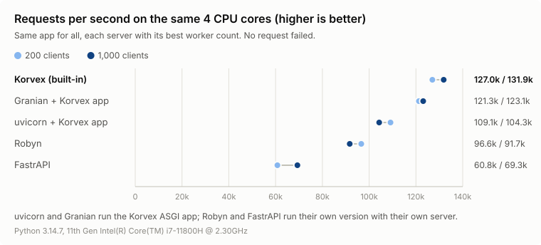

# Korvex

[](https://github.com/3d3n-pyc/korvex/actions/workflows/ci.yml)
[](LICENSE)

A fast router for Python, written in Rust, with an ASGI app on top and a
built-in server to run it.

Korvex is young (alpha). It's fast (see [Performance](#performance)), but it
lacks some of what full frameworks offer: validation, OpenAPI. The [roadmap](ROADMAP.md) lists what's coming.

```sh
pip install korvex
```

## The router

`Router` maps a path and an HTTP method to a handler **name**. It never
calls your code: what you do with the name is up to you.

```python
from korvex import Router

router = Router()
router.get("/users/{id:int}", "get_user")
router.post("/users", "create_user", middleware=["auth"])

router.match("/users/42")         # ("get_user", {"id": 42}, ())
router.match("/users", "POST")    # ("create_user", {}, ("auth",))
router.match("/nope")             # None
router.match("/users", "DELETE")  # raises MethodNotAllowed, .allowed == ["POST"]
```

### Path syntax

| Segment     | Matches                              | Example            |
|-------------|--------------------------------------|--------------------|
| `users`     | exactly `users`                      | `/users`           |
| `{id}`      | any segment                          | `/users/{id}`      |
| `{id:int}`  | an integer (`42`, `-7`)              | `/users/{id:int}`  |
| `{id:uuid}` | a UUID                               | `/items/{id:uuid}` |
| `*path`     | the rest of the path (last segment)  | `/static/*path`    |

`{id:int}` gives an `int` and `{id:uuid}` a `uuid.UUID`; every other
captured value is a string. When several routes could match,
the most specific one wins: literal, then `{id:int}`/`{id:uuid}`, then
`{id}`, then `*path`.

### API

| Method                                           | Does                                                     |
|--------------------------------------------------|----------------------------------------------------------|
| `route(path, handler, *, method="GET", middleware=None)` | Registers a route (replaces an existing one).    |
| `get` / `post` / `put` / `patch` / `delete` / `head` / `options(path, handler, *, middleware=None)` | Shortcuts for `route`. |
| `match(path, method="GET")`                      | `(handler, params, middleware)`, `None`, or raises `MethodNotAllowed`. |
| `remove(path, method="GET")`                     | Removes a route by its pattern. Returns whether it existed. |
| `routes()`                                       | Every route as `(path, method, handler, middleware)`.    |
| `group(prefix, *, middleware=None)`              | A `RouteGroup` (see below).                              |

Invalid paths or methods raise `ValueError`.

`match` keeps the last 1,024 distinct lookups in a cache, and adding or
removing a route clears it. Its results are shared between calls, so they
are immutable: `params` is a read-only mapping and `middleware` a tuple.

### Route groups

```python
api = router.group("/api", middleware=["auth"])
api.get("/users", "list_users")             # GET /api/users, middleware ("auth",)

admin = api.group("/admin", middleware=["admin"])
admin.get("/stats", "stats")                # GET /api/admin/stats, middleware ("auth", "admin")
```

## The ASGI app

`App` runs the matched handler for you. Serve it with any ASGI server
(uvicorn, hypercorn, granian...).

```python
from korvex import App, Depends, Header, HTTPException, Response

app = App()

def signed_in(authorization: str = Header("")) -> None:
    if not authorization:
        raise HTTPException(401, "sign in first")  # stops here

@app.get("/users/{id:int}", dependencies=[Depends(signed_in)])
async def get_user(request, id):
    return Response.json({"id": id})
```

```sh
pip install "korvex[serve]"   # installs uvicorn
uvicorn mymodule:app
```

- Handlers receive the `Request` plus path params as keyword arguments,
  and return a `Response`, sync or async. Checks shared by several routes
  (signing in, permissions) are dependencies: see
  [Dependencies](#dependencies).
- `Request` has `method`, `path`, `headers`, `query_params`,
  `path_params`, `cookies`, `client` (`(host, port)`), `scheme`, and
  `await request.body()`,
  `await request.json()`, `await request.form()`. A form maps each field
  to its values; files from a multipart form are `UploadedFile`s
  (`filename`, `content_type`, `data`). A body that can't be parsed is
  answered with a 400.
- `Response(body, status=, headers=)`, `Response.text(...)`,
  `Response.json(...)`, `Response.redirect(...)`, and
  `response.set_cookie(...)` / `response.delete_cookie(...)`.
- `Response.stream(chunks)` sends a body piece by piece, from a sync or
  async generator. `Response.file(path, filename=None)` sends a file in
  chunks (with `filename`, as a download). `app.static("/static",
  "public")` serves a directory; paths that leave it get a 404.
- `HEAD` requests are answered by the `GET` route, without the body.
- Unknown paths get a 404; known paths with the wrong method get a 405
  with an `Allow` header.
- `@app.before_request` runs before every request, ahead of routing (so
  for unknown paths too), and returns a `Response` to answer right away or
  `None` to carry on. `@app.after_request` gets every response, errors
  included, and returns the one to send (or `None` to keep it).
- `raise HTTPException(404, "user not found")` in a handler, a dependency
  or a before hook answers with that error; `raise Abort(response)` with
  that exact response (a redirect to the sign-in page, say), past the
  exception handlers. `@app.exception_handler(404)` (a status) or
  `@app.exception_handler(ValueError)` (an exception class) customizes the
  response. Any other exception gives a 500 and is logged to the `korvex`
  logger.
- `app.group(prefix, dependencies=[...])` works like `router.group()`,
  with decorators: `api = app.group("/api")`, then `@api.get("/users")`.
  Groups nest; a group's dependencies run before its routes' own.
- Routes registered on `app.router` directly are linked to a function
  with `@app.handler("name")`. The App doesn't run the router's middleware
  names: a route that has some answers a 500, rather than run without
  what may be its guard.
- `@app.on_startup` and `@app.on_shutdown` run a function (sync or async)
  when the server starts and stops, for example to open and close a
  database pool. Shutdown hooks run in reverse order. If a startup hook
  raises, the server doesn't start. Both `@app.on_startup` and
  `@app.on_startup()` work.

### Validation

Type annotations say where a handler's parameters come from. Models can be
[msgspec](https://jcristharif.com/msgspec/) structs or
[pydantic](https://docs.pydantic.dev/) models; Korvex needs neither.

```python
import msgspec

class UserIn(msgspec.Struct):
    name: str
    age: int

class UserOut(msgspec.Struct):
    id: int
    name: str

@app.post("/users")
async def create(request, body: UserIn, notify: bool = False) -> UserOut:
    return UserOut(id=1, name=body.name)
```

- A model (or `list[Model]`) parameter is the JSON body, validated.
- A path parameter's name gets its value, converted to the annotated type.
- Other `str`, `int`, `float`, `bool`, `UUID`, `date` or `datetime`
  parameters (or `Optional` or `list` of them) come from the query string,
  dates in ISO 8601; a default makes them optional. Any other annotation
  is refused when the route is registered.
- A model return annotation turns the returned object into JSON; a
  returned `Response` is sent as is.
- Invalid input gets a 422 with `{"detail": [{"loc": ["body", "age"],
  "msg": ..., "type": ...}]}`. pydantic lists every problem; msgspec stops
  at the first. `@app.exception_handler(422)` changes the response.
- Annotations are read once, when the route is registered: a handler
  without them costs nothing extra, and one that can't be understood fails
  at import.

Headers, cookies and form fields are read the same way, with `Header()`,
`Cookie()` and `Form()` as the default (or in `Annotated[...]`):

```python
from korvex import Cookie, Form, Header, Query, UploadedFile

@app.post("/photos")
async def upload(
    request,
    title: str = Form(),                         # a form field, urlencoded or multipart
    photo: UploadedFile = Form(),                # a file from a multipart form
    x_client: str = Header("web"),               # the X-Client header
    theme: str = Cookie("light"),                # the theme cookie
    page_size: int = Query(20, alias="page-size"),
):
    ...
```

- `x_client` reads `X-Client`: underscores become hyphens, case doesn't
  matter. `alias=` gives the exact name.
- Their errors say where: `["header", "x-client"]`, `["form", "title"]`.
- An empty form field counts as missing, except for `str`.

### Dependencies

`Depends(func)` gives a parameter the value `func` returns. `func` takes
parameters the way a handler does (query, headers, cookies, body, path,
other dependencies), plus the request if it asks for it:

```python
from typing import Annotated, Optional
from korvex import Cookie, Depends, HTTPException

async def current_user(session: Optional[str] = Cookie(None)) -> User:
    user = await users.by_session(session)
    if user is None:
        raise HTTPException(401, "sign in first")
    return user

CurrentUser = Annotated[User, Depends(current_user)]

async def database():
    connection = await pool.acquire()
    try:
        yield connection                     # the handler runs here
    finally:
        await pool.release(connection)

@app.get("/tasks")
async def tasks(request, user: CurrentUser, db=Depends(database)) -> list[Task]:
    return await db.tasks_of(user.id)

api = app.group("/api", dependencies=[Depends(current_user)])  # checks every route in it
```

- A dependency can be sync or async, and stop the request by raising
  `HTTPException`. Within one request it runs once, however many
  parameters ask for it (`Depends(func, cache=False)` runs it each time).
- One that `yield`s is torn down when the handler is done (for a streamed
  response, once the stream is sent). An error from the handler is raised
  at the `yield`, so `try`/`except`/`finally` work there; the error still
  gets its usual response.
- `dependencies=[...]` on a route, a group or a WebSocket runs them for
  what they check rather than what they return. A group's run before its
  routes' own.
- In tests, `app.dependency_overrides[current_user] = lambda: test_user`
  replaces one everywhere.
- Validation errors from dependencies and from the handler come in one
  422.

`app.openapi(title=..., version=...)` describes the API as an OpenAPI 3.1
document: paths, typed parameters (path, query, headers, cookies, those of
dependencies included), JSON and form bodies, response models, and each
handler's docstring (its first line as the summary).
`app.docs(title=..., version=...)` serves it at `/openapi.json`, with
Swagger UI at `/docs` to try the API from a browser (loaded from a CDN;
`docs_path=None` leaves it out).

### WebSockets

```python
@app.websocket("/ws/{room}")
async def chat(ws, room, user: CurrentUser):  # no session: refused (403)
    await ws.accept()
    async for message in ws:  # text or bytes, until the client leaves
        await ws.send_text(f"{user.name} in {room}: {message}")
```

- A `WebSocket` has the handshake's `headers`, `cookies`, `query_params`,
  `path_params`, `client` and `scheme`; `accept(subprotocol=...)`,
  `receive()` (raises `WebSocketDisconnect`), `receive_text/bytes/json`,
  `send_text/bytes/json` and `close(code)`.
- Parameters and dependencies work as for HTTP handlers, without a body.
  A dependency raising `HTTPException` refuses the connection before it
  opens (403); a handler can also `close()` before `accept()` to refuse.
- They work the same under ASGI servers and in the built-in server. Groups
  support them (`api.websocket(...)`), group dependencies included; app
  hooks don't run for them.

### Ready-made hooks

`korvex.middleware` registers hooks for common jobs:

```python
from korvex.middleware import cors

cors(app, allow_origins=["https://example.com"], allow_credentials=True)
```

- `cors(app, allow_origins=..., allow_methods=..., allow_headers=...,
  allow_credentials=False, expose_headers=(), max_age=600)` lets browsers
  call the app from other origins. Preflight requests are answered before
  routing; every response to an allowed origin, errors included, gets the
  CORS headers.
- `request_id(app, header="X-Request-ID", trust_incoming=True)` gives
  every request an ID (the incoming one if it's safe, a new one
  otherwise) and sends it back. `current_request_id()` returns it anywhere
  in your code, `RequestIdFilter` adds it to log records
  (`%(request_id)s`), and the built-in server's access logs show it.
- `rate_limit(app, requests=100, per=60, key=...)` allows each key (the
  client's address by default, or an API key, a user ID...) that many
  requests per period; beyond that, a 429 with `Retry-After`. Responses
  carry `RateLimit-Limit`, `RateLimit-Remaining` and `RateLimit-Reset`.
  Counters live in each worker's memory, so with 3 workers a client can
  get up to 3 times the limit; `store=` takes a shared store instead.

More in [`examples/`](examples/), up to a [complete app](examples/taskboard/)
laid out like a real project. To put it in production (behind nginx or
Caddy, in Docker, on AWS Lambda or Vercel), see the
[deployment guide](docs/deployment.md).

## The built-in server

Korvex can run an `App` without an ASGI server, on Linux and macOS. On the
same CPU cores, it serves 20 to 36% more requests than uvicorn with about
40% less memory (see [Performance](#performance)).

```sh
korvex run main:app --workers 3
```

or, from Python, `app.run(workers=3)`. The same options exist in both:

| Option | Default | Does |
|---|---|---|
| `--host`, `--port` | `127.0.0.1`, `8000` | Address to listen on. |
| `--uds PATH` | | Listen on a Unix socket instead, for a proxy on the same machine. |
| `--workers N` | `1` | Processes sharing the port. About 3 per 4 CPU cores works best. A worker that crashes is restarted. |
| `--graceful-timeout S` | `30` | On Ctrl+C or SIGTERM, seconds requests in progress get to finish. |
| `--max-body BYTES` | 1 MiB | Larger request bodies get a 413, larger WebSocket messages close the connection. A route can set its own: `@app.post("/upload", max_body=50_000_000)`. |
| `--timeout S` | `30` | Seconds a client gets to send the headers, then the body (408 after that). |
| `--forwarded-allow-ips` | `127.0.0.1,::1` | Proxies whose `X-Forwarded-For` and `-Proto` (or `Forwarded`, when neither is there) set `request.client` and `request.scheme`. `*` trusts any. |
| `--forwarded-host` | off | Also believe the host they forward for the `Host` header: `X-Forwarded-Host`, or `Forwarded`'s `host` when there's no `X-Forwarded-For` or `-Proto`. Only if the proxy sets the header it uses itself (nginx passes a client's `X-Forwarded-Host` on as is), and a proxy that uses `Forwarded` must also strip a client's `X-Forwarded-*`. |
| `--access-log` | off | Log each request. |
| `--ws-ping-interval S` | `20` | Seconds between pings on open WebSockets; a client silent until the next ping is closed (1011). `0` turns them off. |

How it works: a Rust thread per worker reads each request in full, without
touching Python, then hands it to the asyncio loop, which runs your
handlers. A slow or huge upload never holds a Python worker.

Things to know:

- Run it behind a reverse proxy (nginx, Caddy, Traefik) in production: it
  speaks HTTP/1.1 and WebSocket; HTTPS, HTTP/2 and HTTP/3 are the proxy's
  job.
- A body over the limit (413), too slow (408) or broken (400) is decided
  by the server, but answered by the app, without the body: before hooks,
  `@app.exception_handler(413)`, after hooks and the access log all apply.
  The connection closes after it.
- A slow client can't make a stream or a WebSocket pile up in memory: once
  1 MiB waits for it, the handler's next send waits until it catches up.
- A proxy passes on the headers it doesn't set as the client wrote them.
  So `Forwarded` (RFC 7239) is only read when there's no `X-Forwarded-For`
  or `-Proto`, which nginx, Caddy and Traefik set; the forwarded host only
  with `--forwarded-host`; and for `-Proto` and `-Host`, the rightmost
  value counts, the one the nearest proxy set.
- The `App` is still a plain ASGI app: uvicorn, Granian or a serverless
  platform keep working, and Windows needs one of them.

## Performance

### Servers

The same app, served by each server on the same 4 CPU cores, each with its
best number of workers:

<picture>
  <source media="(prefers-color-scheme: dark)" srcset="docs/servers-dark.svg">
  
</picture>

| Server | Requests/s, 200 clients | 1,000 clients | RAM |
|---|---|---|---|
| **Korvex built-in** (3 workers) | **126.4k** | **130.5k** | **113 MB** |
| Granian + Korvex app (3 workers) | 111.6k | 113.4k | 196 MB |
| uvicorn + Korvex app (4 workers) | 105.0k | 96.3k | 196 MB |
| Robyn (4 processes, 2 threads each) | 90.3k | 81.9k | 228 MB |

- Granian is a Rust ASGI server too: it does better than uvicorn here, but
  the built-in server still leads, because it skips the ASGI layer.
- Robyn runs its own version of the app with its own Rust server.
- No request failed.

Reproduce with `uv run python benches/servers.py` (needs `cargo install oha`,
takes about 4 minutes).

### Under load

The same small app (1,000 routes, one JSON endpoint) in each framework,
served the same way (uvicorn, one worker, one CPU core) and flooded with
requests to random URLs by [oha](https://github.com/hatoo/oha):

<picture>
  <source media="(prefers-color-scheme: dark)" srcset="docs/load-dark.svg">
  
</picture>

| Framework | Requests/s, 200 clients | p99 latency, 1,000 clients | RAM at rest, peak |
|---|---|---|---|
| **Korvex** | **33.7k** | **26 ms** | **35 MB, 46 MB** |
| Starlette | 3.0k to 30.6k | 35 to 189 ms | 39 MB, 49 MB |
| Falcon | 30.5k | 31 ms | 60 MB, 63 MB |
| Litestar | 18.2k | 79 ms | 78 MB, 89 MB |
| Sanic | 15.8k | 94 ms | 60 MB, 105 MB |
| FastAPI | 1.6k to 12.4k | 57 to 351 ms | 66 MB, 77 MB |
| BlackSheep | 6.7k | 70 ms | 51 MB, 59 MB |
| Django | 1.1k to 2.2k | 1.3 to 1.9 s | 48 MB, 145 MB |

- Every framework uses a full CPU core under load, so requests per second
  is also how much work each one gets out of that core.
- Falcon, and Starlette in its best case, come within about 10% of Korvex.
- Starlette, FastAPI and Django try routes one by one: the ranges go from
  the tested route declared after the 1,000 others to declared first.
  BlackSheep tries them one by one too, but sorts them itself, deepest
  first, so here the tested route always comes last.
- No request failed. Throughput holds steady as clients are added; latency
  grows because requests queue, not because each one gets slower. After
  the flood, memory stays flat and speed is back to normal.

Robyn isn't in this table, since it can't run on uvicorn: it's compared
with Korvex's built-in server above.

Reproduce with `uv run python benches/load_test.py` (needs
`cargo install oha`, takes about 11 minutes).

### Router alone

Route matching only, without any server:

<picture>
  <source media="(prefers-color-scheme: dark)" srcset="docs/benchmark-dark.svg">
  
</picture>

Median time per lookup, 10,000 routes:

| Router | First time a URL is seen | Same URL again (cached) |
|---|---|---|
| **Korvex** | **347 ns** | **67 ns** |
| Litestar | 732 ns | 92 ns |
| Sanic | 3.5 µs | 211 ns |
| Flask | 3.5 µs | (no cache) |
| Django | 1.3 ms | (no cache) |
| Starlette / FastAPI | 1.5 ms | (no cache) |

- Korvex is the fastest in both cases, and its time stays flat as routes
  are added. Django and Starlette try routes one by one, so they slow
  down linearly.
- Korvex, Litestar and Sanic cache the last 1,024 lookups. The cache helps
  most with static URLs; URLs with parameters (`/users/1`, `/users/2`, ...)
  are often different, so they hit it less.
- With few routes, the server and the handler cost more than the router.
  With many routes, a router that tries them one by one becomes the main
  cost (see Under load).

Reproduce with `uv run pytest benches/bench_router.py --benchmark-only
--benchmark-json=benches/results.json`, then `uv run python benches/plot.py`
to redraw both charts. Results depend on the machine: measure your own
workload before relying on any number.

### Validation

One POST with a small JSON body, answered with JSON, run through the app
in-process (no server). Median time per request:

| Handler | Time |
|---|---|
| **Korvex, msgspec models in and out** | **17.8 µs** |
| Korvex, pydantic models in and out | 21.0 µs |
| Korvex, no annotations (`request.json()`, `Response.json()`) | 22.9 µs |
| FastAPI, the same pydantic models | 76.2 µs |

- Validating is faster than not validating here: msgspec and pydantic
  decode and encode JSON in compiled code, `request.json()` and
  `Response.json()` use Python's `json` module.
- Handlers without annotations take the same time as in 0.6, validated
  ones the same as in 0.7 (measured side by side).

Reproduce with `uv run pytest benches/bench_validation.py --benchmark-only`.

### Dependencies

One GET whose handler gets the user from a header and opens then closes a
session, run through the app in-process. Median time per request, from one
run on the same machine:

| Handler | Time |
|---|---|
| Korvex, the handler does it itself | 20.4 µs |
| **Korvex, two dependencies (one with `yield`) and `Header()`** | **27.5 µs** |
| FastAPI, the same dependencies, async | 100.5 µs |
| FastAPI, the same dependencies, sync | 433 µs |

- FastAPI runs sync dependencies in a thread pool, which keeps a blocking
  one from stopping the event loop but costs a lot. Korvex calls them on
  the loop, like sync handlers: keep blocking work out of them, or make
  them async.
- Dependencies are worked out when the route is registered; a handler
  without them pays nothing.

Reproduce with `uv run pytest benches/bench_dependencies.py --benchmark-only`.

## Development

```sh
uv run maturin develop --release   # build the Rust extension
uv run pytest                      # Python tests
cargo test                         # Rust tests
```

See [CONTRIBUTING.md](CONTRIBUTING.md), and [ROADMAP.md](ROADMAP.md) for
what's planned.

## License

[MIT](LICENSE)
