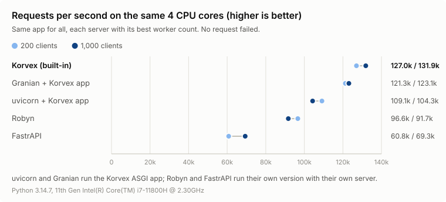
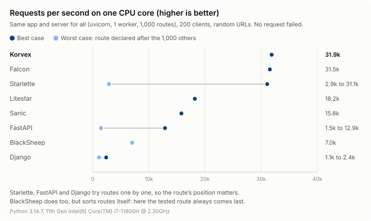
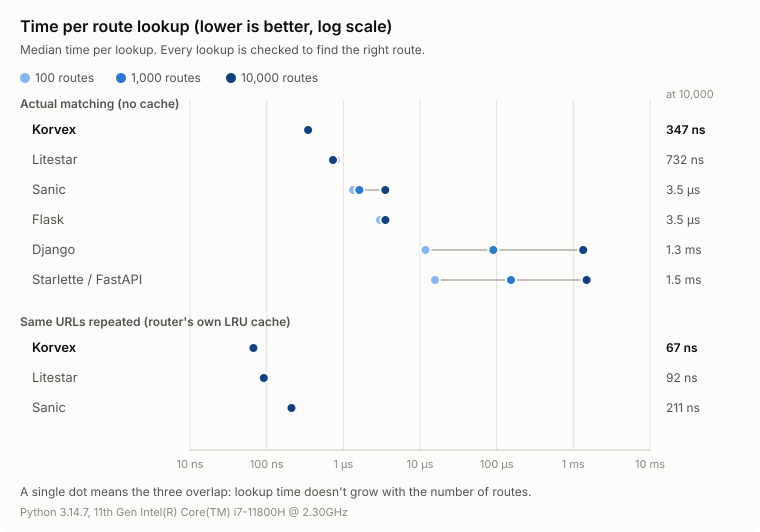

# Performance

All numbers come from the scripts in [`benches/`](../benches/), on one
machine. Results depend on the machine: measure your own workload before
relying on any of them.

## Servers

The same app, served by each server on the same 4 CPU cores, each with its
best number of workers. Measured with Korvex 0.14 and FastrAPI 0.2.11:

<picture>
  <source media="(prefers-color-scheme: dark)" srcset="servers-dark.svg">
  
</picture>

| Server | Requests/s, 200 clients | 1,000 clients | RAM |
|---|---|---|---|
| **Korvex built-in** (3 workers) | **111.3k** | **115.2k** | **124 MB** |
| Granian + Korvex app (3 workers) | 106.0k | 114.0k | 198 MB |
| uvicorn + Korvex app (4 workers) | 103.8k | 98.5k | 206 MB |
| Robyn (4 processes, 2 threads each) | 94.3k | 85.6k | 230 MB |
| FastrAPI (1 process) | 59.7k | 63.9k | 114 MB |

- Granian is a Rust ASGI server too: it comes close, within 1% at 1,000
  clients and 5% at 200. The built-in server skips the ASGI layer, and
  uses 40% less memory.
- Robyn and FastrAPI run their own version of the app with their own
  Rust server. FastrAPI runs one process (it has no workers option, and a
  second process can't share the port): its Rust side uses the 4 cores,
  but one Python process, under the GIL, runs every handler. Its handlers
  are sync: in 0.2.11, async ones answer a 500.
- No request failed.
- The built-in server served 126k and 130k requests/s when this was first
  measured, with Korvex 0.6. The others come within 5% of their numbers
  then, so the machine hasn't changed; Korvex has. Measured version by
  version, one worker on one core, the loss came at once with 0.7 (6.5%),
  and nothing since. Its cause isn't found yet: the Python code 0.7 added
  to the request path costs a tenth of it, and it isn't the garbage
  collector.

Reproduce with `uv run --group bench python benches/servers.py` (needs `cargo install oha`,
takes about 5 minutes).

## Under load

The same small app (1,000 routes, one JSON endpoint) in each framework,
served the same way (uvicorn, one worker, one CPU core) and flooded with
requests to random URLs by [oha](https://github.com/hatoo/oha). Measured
with Korvex 0.14:

<picture>
  <source media="(prefers-color-scheme: dark)" srcset="load-dark.svg">
  
</picture>

| Framework | Requests/s, 200 clients | p99 latency, 1,000 clients | RAM at rest, peak |
|---|---|---|---|
| **Korvex** | **30.7k** | **29 ms** | **38 MB, 49 MB** |
| Starlette | 2.8k to 30.4k | 34 to 202 ms | 40 MB, 49 MB |
| Falcon | 29.0k | 29 ms | 61 MB, 63 MB |
| Litestar | 17.6k | 40 ms | 85 MB, 92 MB |
| Sanic | 14.9k | 131 ms | 63 MB, 105 MB |
| FastAPI | 1.6k to 11.6k | 59 to 378 ms | 67 MB, 77 MB |
| BlackSheep | 6.6k | 73 ms | 51 MB, 59 MB |
| Django | 1.1k to 2.1k | 1.3 s to 1.6 s | 52 MB, 147 MB |

- Every framework uses a full CPU core under load, so requests per second
  is also how much work each one gets out of that core.
- Starlette in its best case comes within 1% of Korvex, Falcon within 6%.
  Korvex served 8% more when this was first measured, with 0.6 (see
  Servers above).
- Starlette, FastAPI and Django try routes one by one: the ranges go from
  the tested route declared after the 1,000 others to declared first.
  BlackSheep tries them one by one too, but sorts them itself, deepest
  first, so here the tested route always comes last.
- No request failed. Throughput holds steady as clients are added; latency
  grows because requests queue, not because each one gets slower. After
  the flood, memory stays flat and speed is back to normal.

Robyn and FastrAPI aren't in this table, since they can't run on
uvicorn: they're compared with Korvex's built-in server above.

Reproduce with `uv run --group bench python benches/load_test.py` (needs
`cargo install oha`, takes about 11 minutes).

## Router alone

Route matching only, without any server:

<picture>
  <source media="(prefers-color-scheme: dark)" srcset="benchmark-dark.svg">
  
</picture>

Median time per lookup, 10,000 routes:

| Router | First time a URL is seen | Same URL again (cached) |
|---|---|---|
| **Korvex** | **347 ns** | **67 ns** |
| Litestar | 732 ns | 92 ns |
| Sanic | 3.5 µs | 211 ns |
| Flask | 3.5 µs | (no cache) |
| Django | 1.3 ms | (no cache) |
| Starlette / FastAPI | 1.5 ms | (no cache) |

- Korvex is the fastest in both cases, and its time stays flat as routes
  are added. Django and Starlette try routes one by one, so they slow
  down linearly.
- Korvex, Litestar and Sanic cache the last 1,024 lookups. The cache helps
  most with static URLs; URLs with parameters (`/users/1`, `/users/2`, ...)
  are often different, so they hit it less.
- With few routes, the server and the handler cost more than the router.
  With many routes, a router that tries them one by one becomes the main
  cost (see Under load).

Reproduce with `uv run --group bench pytest benches/bench_router.py --benchmark-only
--benchmark-json=benches/results.json`, then `uv run --group bench python benches/plot.py`
to redraw both charts.

## Validation

One POST with a small JSON body, answered with JSON, run through the app
in-process (no server). Median time per request, with Korvex 0.14:

| Handler | Time |
|---|---|
| **Korvex, msgspec models in and out** | **18.1 µs** |
| Korvex, pydantic models in and out | 21.1 µs |
| Korvex, no annotations (`request.json()`, `Response.json()`) | 23.8 µs |
| FastAPI, the same pydantic models | 72.6 µs |

- Validating is faster than not validating here: msgspec and pydantic
  decode and encode JSON in compiled code, `request.json()` and
  `Response.json()` use Python's `json` module.

Reproduce with `uv run --group bench pytest benches/bench_validation.py --benchmark-only`.

## Dependencies

One GET whose handler gets the user from a header and opens then closes a
session, run through the app in-process. Median time per request, with
Korvex 0.14:

| Handler | Time |
|---|---|
| Korvex, the handler does it itself | 19.1 µs |
| **Korvex, two dependencies (one with `yield`) and `Header()`** | **25.9 µs** |
| FastAPI, the same dependencies, async | 90.8 µs |
| FastAPI, the same dependencies, sync | 393 µs |

- FastAPI runs sync dependencies in a thread pool, which keeps a blocking
  one from stopping the event loop but costs a lot. Korvex calls them on
  the loop, like sync handlers: keep blocking work out of them, or make
  them async.
- Dependencies are worked out when the route is registered; a handler
  without them pays nothing.

Reproduce with `uv run --group bench pytest benches/bench_dependencies.py --benchmark-only`.

## Threads on free-threaded Python

The built-in server on the same 4 cores as above, the same app and load
(200 connections), with more threads or more workers. One run:

| Python, workers, threads | Requests/s | p99 | Memory |
|---|---|---|---|
| 3.14t, 1 worker, 1 thread | 71,096 | 4.6 ms | 39 MiB |
| 3.14t, 1 worker, 2 threads | 98,839 | 3.8 ms | 43 MiB |
| **3.14t, 1 worker, 3 threads** | **111,317** | 4.6 ms | **46 MiB** |
| 3.14t, 1 worker, 4 threads | 103,378 | 6.0 ms | 49 MiB |
| 3.14t, 2 workers, 1 thread | 119,674 | 3.1 ms | 98 MiB |
| 3.14t, 4 workers, 1 thread | 116,183 | 4.1 ms | 159 MiB |
| 3.14 (GIL), 1 worker, 1 thread | 59,301 | 4.9 ms | 32 MiB |
| 3.14 (GIL), 1 worker, 2 threads | 58,653 | 2.5 ms | 33 MiB |
| 3.14 (GIL), 4 workers, 1 thread | 98,304 | 4.6 ms | 124 MiB |

- On 3.14t, 3 threads serve 57% more than one, within 4% of 4 workers,
  with a third of the memory. Past 3, they don't gain: each loop has its
  Rust thread too, so 4 of them already keep 8 threads busy on 4 cores.
- With the GIL, threads don't help: use workers.
- Workers still serve the most; threads are for when memory counts (one
  copy of the app, its caches and connection pools per process).
- `compress()` leaves brotli out on 3.14t: the `brotli` package turns the
  GIL back on for the whole process. CI checks that nothing else does.

Reproduce with `KORVEX_FT_PYTHON=/path/to/3.14t/python uv run --group bench python
benches/threads.py` (see the file for the setup).

## With a database

Each request reads one row from PostgreSQL through an asyncpg pool, then
answers with JSON: the least a real API does. PostgreSQL gets 2 cores of
its own, the server 4, each server 3 workers. Two runs:

| Server | Requests/s | p99 | Memory |
|---|---|---|---|
| Korvex, built-in server | 21,660 / 21,380 | 37.7 / 32.4 ms | 133 MiB |
| Korvex on uvicorn | 22,035 / 23,524 | 30.9 / 23.5 ms | 170 MiB |
| FastAPI on uvicorn | 13,407 / 15,356 | 41.7 / 41.6 ms | 229 MiB |

- The database sets the pace: Korvex's two servers serve about the same,
  uvicorn a little more in the second run, and the built-in server's lead
  of the tests above is gone. It still uses the least memory.
- FastAPI serves 35 to 40% less: its own cost per request comes on top of
  the database's.

Reproduce with `uv run --group bench python benches/database.py` (needs podman or
docker for PostgreSQL, and oha).
